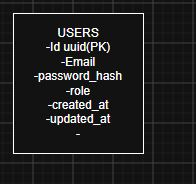
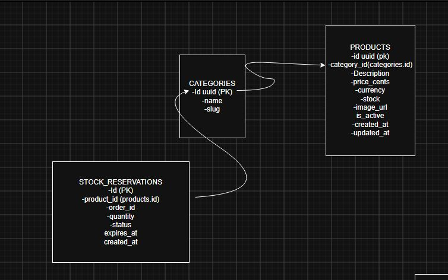
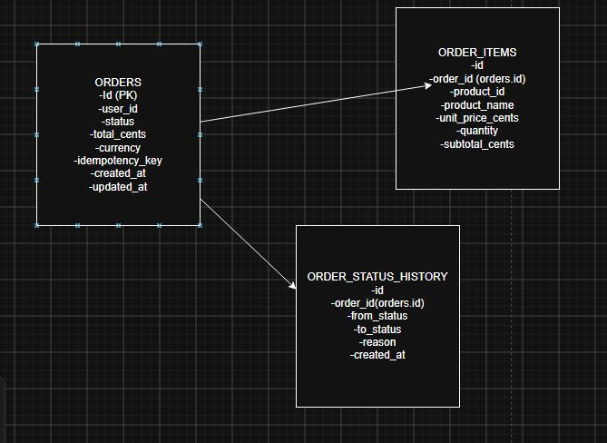
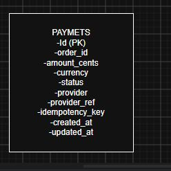

# Sistema de Pedidos - Microservicios en Go

> Arquitectura moderna de microservicios con Go + PostgreSQL. Sistema escalable de gestión de pedidos con 4 servicios independientes.

## 🎯 Descripción

Sistema backend que implementa **4 microservicios desacoplados** (Users, Products, Orders, Payments), cada uno con su propia base de datos PostgreSQL. Demostra patrones de arquitectura limpia, DDD y API REST profesional.

## 🚀 Características

**Backend:**
- ✅ Arquitectura Limpia con separación clara (Handler → Service → Repository)
- ✅ Microservicios independientes con BDs desacopladas
- ✅ Autenticación JWT con tokens seguros
- ✅ GORM ORM + PostgreSQL
- ✅ Logging estructurado con slog
- ✅ CORS configurado
- ✅ Graceful shutdown

**Frontend:**
- ✅ React + TypeScript
- ✅ Vite (build rápido)
- ✅ Componentes reutilizables

## 🛠️ Stack

| Componente | Tech |
|-----------|------|
| **Backend** | Go 1.26, Gin 1.12, GORM 1.31 |
| **Base de Datos** | PostgreSQL (4 instancias) |
| **Auth** | JWT v5.3.1 |
| **Frontend** | React, TypeScript, Vite |

## 🏗️ Arquitectura

```
┌─────────────────┐
│   Frontend      │
│  (React + TS)   │
└────────┬────────┘
         │ HTTP/REST
┌────────▼────────────────────────────────┐
│         API Gateway (Gin)                │
├────┬──────────┬──────────┬──────────┐
│    │          │          │          │
▼    ▼          ▼          ▼          ▼
Users  Products  Orders  Payments
```

**4 Microservicios independientes:**
- **Users**: Autenticación y gestión de usuarios
- **Products**: Catálogo y control de stock
- **Orders**: Gestión de pedidos y historial
- **Payments**: Procesamiento de pagos con idempotencia

## ⚡ Quick Start

### Backend
```bash
cd backend
# Crear 4 bases de datos PostgreSQL
# Configurar .env
go run ./cmd/api/main.go
```

### Frontend
```bash
cd frontend
npm install
npm run dev
```

Server: `http://localhost:8080`
Frontend: `http://localhost:5173`

## 📚 Modelos de Datos

### Users Service

- Autenticación JWT
- Roles y permisos
- Contraseñas hasheadas

### Products Service

- Catálogo de productos
- Control de stock
- Reservas de inventario

### Orders Service

- Estados: pending → processing → shipped → delivered
- Historial completo de cambios
- Datos de envío

### Payments Service

- Soporte para idempotencia
- Métodos: credit_card, debit_card, transfer
- Estados: pending, approved, failed, refunded

## 🔌 API Endpoints

### Users
```bash
POST   /api/v1/users/register
POST   /api/v1/users/login
GET    /api/v1/users/profile  (requiere token)
```

### Products
```bash
GET    /api/v1/products?category_id=1
POST   /api/v1/products  (admin)
```

### Orders
```bash
POST   /api/v1/orders
GET    /api/v1/orders
PATCH  /api/v1/orders/{id}/status
```

### Payments
```bash
POST   /api/v1/payments
GET    /api/v1/payments/{id}
```

## ⚙️ Configuración

Crear `.env` en `backend/`:

```env
DB_HOST=localhost
DB_PORT=5432
DB_USER=postgres
DB_PASSWORD=your_password

USERS_DB_NAME=sistema_users
PRODUCTS_DB_NAME=sistema_products
ORDERS_DB_NAME=sistema_orders
PAYMENTS_DB_NAME=sistema_payments

APP_PORT=8080
APP_ENV=development
JWT_SECRET=your_secret_key
JWT_EXPIRATION_HOUR=24
```

## 🧪 Desarrollo

```bash
cd backend

# Tests
go test ./...

# Lint
go fmt ./...
go vet ./...

# Hot reload (con air)
air
```

## 🔐 Seguridad

✅ Implementado:
- JWT token-based auth
- Password hashing
- CORS configurado
- SQL injection prevention (GORM)
- Request logging

⚠️ Producción:
- HTTPS/TLS
- Rate limiting
- DDoS protection
- Secrets management (Vault)
- API Key rotation

## 📈 Escalabilidad

**Horizontal:** Cada servicio en instancia separada
**Vertical:** PostgreSQL replicación y caché Redis
**Futuro:** Event-driven con Kafka, Service mesh, Monitoring

## 🎯 Aprendizajes Clave

Este proyecto demuestra:
- ✅ Arquitectura Limpia en Go
- ✅ Microservicios con DDD
- ✅ API REST profesional
- ✅ Manejo de errores robusto
- ✅ Logging estructurado
- ✅ Composición de dependencias
- ✅ Frontend-Backend integration

## 📝 Licencia

MIT

## 👨‍💻 Autor

**Rodrigo Fagundez**  
GitHub: [@RodrigoFagundez2004](https://github.com/RodrigoFagundez2004)

---

**Estado:** ✅ Production Ready
